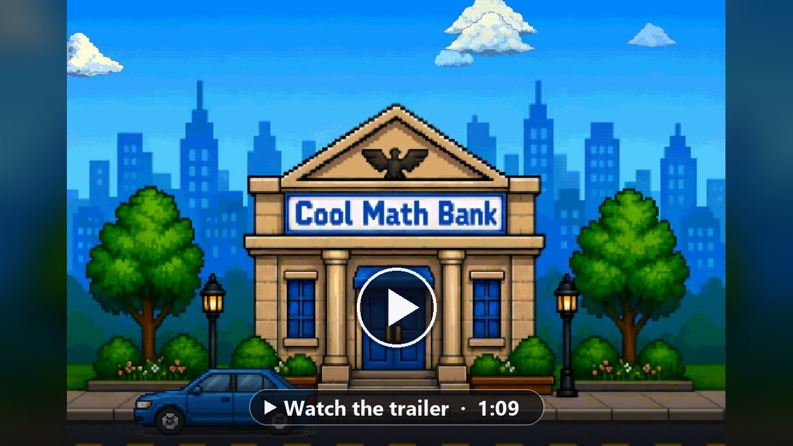
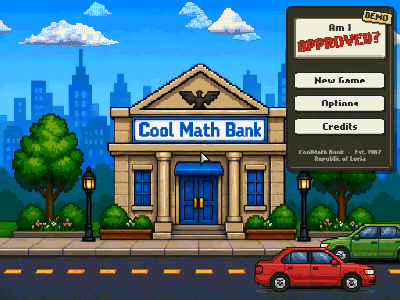
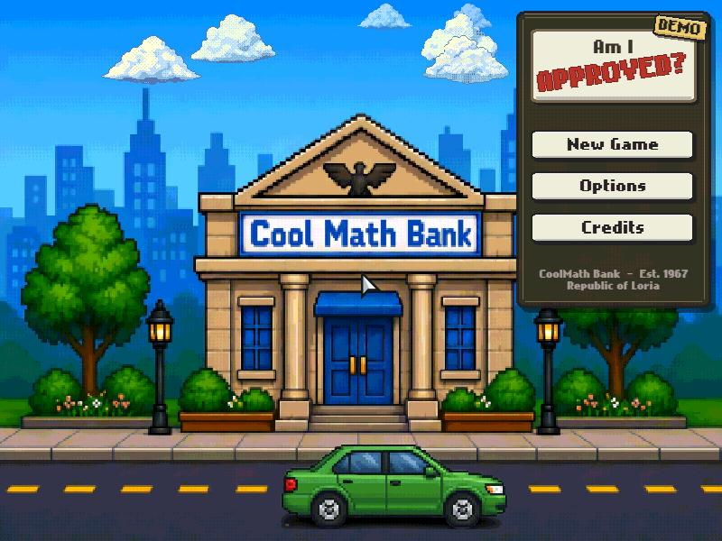
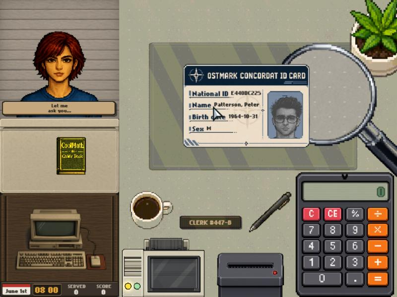
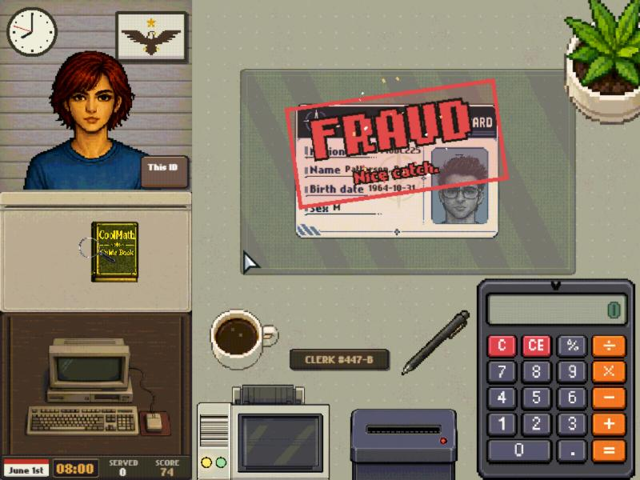
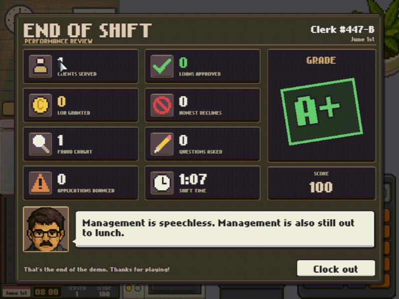

# Am I Approved?

A bureaucratic loan desk sim set in the Republic of Loria, circa 1967. You were hired as employee **#447-B** to approve loans, reject loans, and look busy between visitors. Management has full confidence in you. Management also left early.

**[Play the demo in your browser →](https://marysue.itch.io/am-i-approved)** · **[Watch the trailer on YouTube →](https://youtu.be/uLAc5yxb73E)**

<p align="center">
  <a href="https://youtu.be/uLAc5yxb73E"></a>
</p>

## About

Clients arrive at your desk with stories, ID cards, and paperwork that does not always add up. Your job is to listen, inspect, compare, and decide who gets the money.

<p align="center">
  
</p>

**This is a demo:** one short shift with Chef's training and three cases, ending in your performance review. Approve the honest loan, decline the one the numbers won't support, and catch the client holding someone else's ID.

**What you'll do**

- **Talk to clients** — small talk, pointed questions, and the occasional lie you pretend not to notice
- **Inspect documents** — drag passports, ID cards, and contracts onto your desk and cross-check every detail
- **Work on the computer** — search the citizen database, edit records, and file loan applications on a green-screen bank terminal

**Features**

- Client dialogue and scenarios with dry, workplace humor
- Document inspection and comparison — passports, IDs, contracts, and more
- Retro bank terminal with citizen search, loan applications, and calculators
- Three hand-picked demo cases: a wedding loan with a sneaky yearly bill, a second boat that deserves an honest decline, and a stolen ID
- Chef's hands-on training with a lesson tracker (or skip it if you've done this before)
- Stamps, coin showers, and an end-of-shift performance review with a grade
- Walnut-and-brass UI with paper speech bubbles, springy buttons and popups, and a live score in the status bar
- A living office: wall clock, coworkers passing by, desk toys
- A short field-manual Guide Book that Chef hands you in person
- Tutorial and employee handbook to walk you through day one
- A fully stocked desk: printer, shredder, calculator, loan folder, magnifying glass, and too much paperwork

## Screenshots

<table>
  <tr>
    <td width="50%" valign="top">
      <strong>Main menu</strong> — Clock in at CoolMath Bank. Traffic rolls by, and the APPROVED? stamp lands with a thump.
      <br><br>
      
    </td>
    <td width="50%" valign="top">
      <strong>The desk</strong> — Drag documents onto your desk and read them closely. Your magnifying glass, calculator, printer, and shredder are all within reach.
      <br><br>
      
    </td>
  </tr>
  <tr>
    <td width="50%" valign="top">
      <strong>Trust nobody</strong> — Compare the face at your window with the photo on the ID. Catch a fake and it gets stamped on the spot.
      <br><br>
      
    </td>
    <td width="50%" valign="top">
      <strong>End of shift</strong> — Chef reviews your work: loans granted, honest declines, frauds caught, and a final grade.
      <br><br>
      
    </td>
  </tr>
</table>

## Coolmath Game Jam 2026

This game was created for **[The $20K Coolmath Game Jam 2026](https://itch.io/jam/coolmath-game-jam-2026)**, hosted by Coolmath Games. The jam theme was **Break the Bank** — games about using money wisely and teaching financial literacy.

*Am I Approved?* puts those ideas into practice: you evaluate loan requests, compare income and expenses, spot inconsistencies in documents, and decide who can afford to borrow. The in-game project name *Break the Bank* reflects the jam theme; the public title is *Am I Approved?*

## Credits

| Role | Name |
| --- | --- |
| Game designer / programmer | Viktar Syanau (MarySue) |
| Artist | Anush Kalivanjyan |
| Composer / audio effects | Bohdan Potomskyi (retipupu) |
| Scenarist | Serik - Al Farabiuly Yerasyl |

**Special thanks:** Valeria Paziuk, Vadzim Trayeuski (HonieHomie), Muhammad Bakanaev (Senshi), Muzafar Bektas (horseatersson)

Sounds from [freesound.org](https://freesound.org)

## Development

Built with **HaxeFlixel** on **OpenFL**, targeting **800×600** (HTML5 and desktop).

**Requirements:** Haxe, OpenFL, Lime, HaxeFlixel

```bash
lime build html5
lime test html5
```

**Release build and itch.io zip** (patches `index.html` for itch.io hosting):

```powershell
.\scripts\package_itchio.ps1
```

Output: `dist/BreakTheBank-itchio.zip`

**itch.io page art:** the banner, cover and page backgrounds are in `assets/itch/`.
